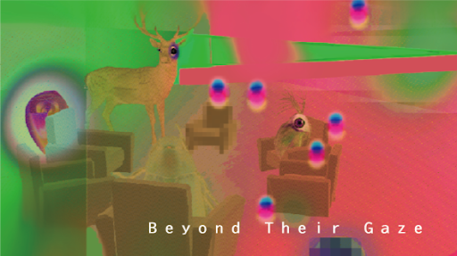

# 128th metaPhorest Seminar

Friday, November 27, 2026, 19:00–21:00

  
## 128th metaPhorest Seminar by Nene Koyama + Tomoki Matsumura + Ayaka Abe + Yuga Tsukuda  
  
#### This event will be primarily in Japanese, but questions and comments in English are also welcome.
At the November 27 (Friday) metaPhorest Seminar, metaPhorest members Nene Koyama and Tomoki Matsumura will welcome artists Ayaka Abe and Yuga Tsukuda to introduce their group exhibition, "Their Gaze, and Us Beyond It." Through the exhibition's curatorial background and their individual artistic practices, they will explore relationships between humans and nonhumans and different ways of perceiving the world.  
There will also be time for informal discussion after the seminar. We look forward to seeing you there!  
  
Friday, November 27, 2026, 19:00–21:00  
Seminar Room 3, 3rd Floor, Waseda University Joint Institution for Advanced Biomedical Sciences (TWIns)  
https://maps.app.goo.gl/Wy23SqPPMo3P7V8JA  
  
::: tip ONLINE (The video quality of the online stream may be limited, so we encourage participants to attend in person whenever possible.)
This seminar will also be available online. [Zoom Link](https://zoom.metaphorest.org)
:::
  
#### "Their Gaze, and Us Beyond It" — Rethinking the World Through Nonhuman Perception and Embodiment
In this seminar, we will discuss the curatorial background and artistic practices behind the group exhibition "Their Gaze, and Us Beyond It," currently on view at the gallery Up & Coming (November 18–December 20, 2026). The four speakers are Nene Koyama, Tomoki Matsumura, Ayaka Abe, and Yuga Tsukuda. The exhibition brings together four artists born in the late 1990s who share an interest in living organisms and technology. It approaches the gaze not merely as an act of seeing, but as a force involving agency and power relations. Through relationships between humans and nonhuman beings, the exhibition seeks to reconsider the frameworks of perception, embodiment, and intelligence that we have taken for granted. The seminar will begin with an overview of the exhibition and its structure. In the second half, each artist will introduce themselves and discuss their works. By exploring diverse approaches and creative processes, including kinetic art, bioart, projects involving the body and ecosystems, visual experiments using crystalline lenses from living organisms, and attempts to approach insects as components and media, we will seek new ways of perceiving the world beyond a human-centered perspective.  
  
#### Nene Koyama
Born in Gifu Prefecture in 1999. Koyama completed her graduate studies at the Graduate School of Art and Design, Tama Art University, in 2025 and is currently a doctoral student at the Graduate School of Advanced Science and Engineering, Waseda University. Driven by an interest in living organisms and things that move, she creates kinetic art and bioart. Her main themes are relationships between humans and nonhumans, and humans as seen from nonhuman perspectives. Exploring questions such as how other living beings perceive a world different from our own and where the boundary between living and nonliving things lies, she works with a variety of materials and methods, including machines, living organisms, odors, and video. In recent years, she has also become interested in how humans perceive, assign meaning to, and aesthetically appreciate other living beings and objects.  
https://nenekoyama.github.io/my-website/  
  
#### Tomoki Matsumura
Born in Tokyo in 1997. Matsumura graduated from the School of Advanced Science and Engineering, Waseda University, in 2021 and is a former member of Japan's national finswimming team. Since joining metaPhorest in 2020, he has developed art projects exploring ecosystems and biological phenomena. Working at the intersection of the body, technology, and nature, he continues to explore ways of reconstructing the boundaries between humans and ecosystems.  
https://tomoki-matsumura.com/works/  
  
#### Ayaka Abe
Born in Kanagawa Prefecture in 1996. Abe completed her graduate studies in New Media at the Graduate School of Film and New Media, Tokyo University of the Arts, in 2024. She uses crystalline lenses from living organisms as optical lenses to capture their habitats and the organisms they interact with. She approaches vision as an act intertwined with ecology and bodily sensations, training visceral perception through the act of seeing. Through her artistic practice, she experiments, creates, and builds to allow the sensations of other forms of life to resonate within the body, seeking fleeting moments when seemingly disparate phenomena suddenly become interconnected and an entire world emerges within the body as a coherent system.  
https://abecodium.com/  
  
#### Yuga Tsukuda
Born in 1999. Tsukuda graduated from the School of Informatics, University of Tsukuba, and is currently pursuing graduate studies in Intermedia Art at Tokyo University of the Arts. Rather than treating insects merely as objects of observation, he approaches them as components in electronic circuits that transform environmental conditions and signals, creating works that explore the relationship between life and media. Through works that translate cockroach movements into handwriting and use the sound-producing organs of cicadas as acoustic devices, he has reinterpreted biological bodies as information-processing and output devices. In recent years, he has been exploring the surface structures of scarab beetles as optical components, investigating how insect bodies can transform light, electricity, moving images, and the act of viewing art.  
https://yuga-tsukuda.amebaownd.com/pages/3270260/page_201602191132
