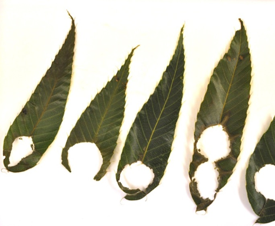

---
layout: doc
outline: deep
prev:
  text: 'Seminars'
  link: '/seminars/'
---

# 129th metaPhorest Seminar

Friday, December 4, 2026, 19:00–21:00

## 129th metaPhorest Seminar by AKI INOMATA + Mutsumi Ito

#### This event will be primarily in Japanese, but questions and comments in English are also welcome.
At the December 4 (Friday) metaPhorest Seminar, metaPhorest member AKI INOMATA will welcome ecologist Mutsumi Ito as a guest. Focusing on the unique leaf-eating behavior of Japanese giant flying squirrels, Ito will introduce the world of animal ecology through the distinctive feeding traces they leave behind.  
There will also be time for informal discussion after the seminar. We look forward to seeing you there!  
  
Friday, December 4, 2026, 19:00–21:00  
Seminar Room 3, 3rd Floor, Waseda University Joint Institution for Advanced Biomedical Sciences (TWIns)  
https://www.waseda.jp/top/access/twins
  
::: warning
This seminar will not be streamed via Zoom. We warmly encourage you to attend in person.
:::
  
#### Why Do Japanese Giant Flying Squirrels Fold Leaves?
Many mammals inhabiting Japan are nocturnal and live quietly in forests, making it difficult to collect data through direct observation of their behavior. Mammal researchers therefore often rely on trace surveys, using clues such as droppings, footprints, and feeding traces to investigate the presence and behavior of animals. The Japanese giant flying squirrel is a large nocturnal squirrel that travels by gliding and spends almost its entire life in trees. These characteristics alone give some idea of how difficult it is to study this animal. Fortunately, however, these squirrels have a highly unusual way of eating leaves: they fold a leaf and then eat through the folded section, leaving behind distinctive feeding traces with origami-like creases. There must be some reason why they go to such trouble while perched precariously in trees. In this seminar, I will introduce the various hypotheses inspired by these feeding traces, how they have been tested, and the world of animal ecology that has opened up through conversations with the many eccentrics I have encountered along the way.
  
#### Mutsumi Ito
Mutsumi Ito holds a PhD in Science and specializes in ecology. She received her doctorate from Tokyo Metropolitan University in 2020 for her research on plant–animal interactions, focusing on the leaf-eating behavior of Japanese giant flying squirrels. She is currently quietly writing academic papers while disguised as an office worker.  
  
Related publications

- Ito, M., Uenishi, M., Okano, R., & Hayashi, F. (2026). Origami by the Japanese giant flying squirrels: how to fold a tree leaf efficiently before eating it. acta ethologica, 29(1), 4.
- Ito, M., Seto, N., Rico, B., Shigeta, M., Tamura, N., & Hayashi, F. (2016). Folivory with leaf folding by giant flying squirrels: Its patterns and possible function. Ecological Research, 31(5), 617-626.
  
#### AKI INOMATA
Artist and Visiting Professor, Department of Sculpture, Musashino Art University.  
Born in Tokyo in 1983.  
Her major solo exhibitions include those at Kunstmuseum Bonn (2026); 21st Century Museum of Contemporary Art, Kanazawa (2022); Towada Art Center (2019); and Musée d'arts de Nantes (2018). Her major international exhibitions include the Shanghai Biennale (2025); Bangkok Art Biennale (2024); Aichi Triennale 2022; Toronto Biennial of Art (2019); and the 22nd Triennale Milano (2019). Her works are held in major collections including the Museum of Modern Art, New York; Art Gallery of South Australia; Castello di Rivoli Museum of Contemporary Art; The National Museum of Modern Art, Kyoto; Mori Art Museum; and 21st Century Museum of Contemporary Art, Kanazawa.
