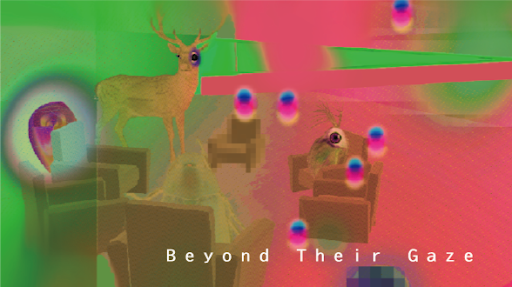

# 128th metaPhorest セミナー

2026年11月27日（金）19:00-21:00

  
## 128th metaPhorest Seminar by 古山寧々 Nene Koyama + 松村寛季 Tomoki Matsumura + 阿部文香 Ayaka Abe + 佃優河 Yuga Tsukuda  
  
#### This event will be primarily in Japanese, but questions and comments in English are also welcome.
11/27（金）のmetaPhorestセミナーでは、メンバーの古山寧々と松村寛季が、アーティストの阿部文香さん、佃優河さんをお招きし、4名によるグループ展「彼らのまなざし、その先の私たち」について紹介します。展覧会の企画背景やそれぞれの制作実践を通じて、人間と非人間の関係や知覚のあり方について考えます。  
セミナー後の懇談タイムもあります。ぜひお越しください！   
      
2026年11月27日 (金) 19:00–21:00  
早稲田大学 先端生命医科学研究施設（TWIns）3F セミナールーム3  
https://maps.app.goo.gl/Wy23SqPPMo3P7V8JA  
  
::: tip ONLINE （映像の画質が悪いため、可能な方はぜひ現地へお越しください）  
This seminar can also be held online. [Zoom Link](https://zoom.metaphorest.org)
:::
  
#### 「彼らのまなざし、その先の私たち」——非人間の知覚と身体から問い直す世界  
本セミナーでは、ギャラリー「Up & Coming」にて開催中のグループ展「彼らのまなざし、その先の私たち」（2026年11月18日〜12月20日）の企画背景と、参加作家の制作実践についてお話しします。登壇するのは、古山寧々、松村寛季、阿部文香、佃優河の4名です。   「彼らのまなざし、その先の私たち」は、生物やテクノロジーに関心を寄せる1990年代後半生まれの4名によるグループ展です。〈まなざし〉を単なる視覚行為ではなく、主体性や権力関係を含んだ力として捉え、人間と非人間的な存在との関係を通じて、私たちが自明としてきた知覚・身体・知性の枠組みを見つめ直すことを試みています。セミナーではまず、こうした展覧会全体の概要や構成についてご紹介します。後半では、4名の作家それぞれによる自己紹介と作品の解説を行います。キネティック作品やバイオアート、身体と生態系をめぐるプロジェクト、生物の水晶体を用いた視覚実験、昆虫を素子やメディアとして捉える試みなど、多様なアプローチや制作プロセスを辿りながら、人間中心の視点から一歩離れた新たな世界の捉え方を探ります。  
  
#### 古山寧々 Nene Koyama  
1999年岐阜県生まれ。2025年多摩美術大学大学院美術研究科修了。現在は早稲田大学大学院先進理工学研究科博士後期課程に在籍。生き物や動くものへの関心から、キネティック作品やバイオアートを制作している。主なテーマは「人間と非人間の関係性」や「非人間から見た人間」。生き物は人間とは違う世界をどのように見ているのか、生命とそうでないものはどこで分けられるのか、といった問いをもとに、機械、生物、匂い、映像などさまざまな素材や方法を用いて制作している。近年は、人間が他の生き物や物をどのように見て、意味づけ、「鑑賞」しているのかにも関心を持っている。  
https://nenekoyama.github.io/my-website/  
  
#### 松村寛季 Tomoki Matsumura  
1997年東京生まれ。2021年、早稲田大学先進理工学部卒業。元フィンスイミング日本代表。2020年にmetaPhorestに加入してから、生態系や生命現象をテーマにしたアートプロジェクトを展開。身体、テクノロジー、そして自然が交差する地点で、人間と生態系の境界線を再構築する試みを続けている。  
https://tomoki-matsumura.com/works/  
  
#### 阿部文香 Ayaka Abe  
1996年神奈川県生まれ。2024年、東京藝術大学大学院映像研究科メディア映像専攻修了。生物の水晶体をレンズとして、生息環境や関わる生物を撮影する。視覚を、生態や身体感覚と結びついた行為として捉え、見ることから内臓感覚を訓練する。作品を通して、身体に別の生態の感覚を通わせること、ふとあらゆる事象が繋がりひとつの体系として体内に完全な世界が立ち上がる様な刹那的瞬間のために、実験し制作し建築する。  
https://abecodium.com/  
  
#### 佃優河 Yuga Tsukuda  
1999年生まれ。筑波大学情報学群卒業。現在、東京藝術大学大学院先端芸術表現専攻に在籍。昆虫を単なる観察対象ではなく、環境や信号を変換する電子回路上の素子として捉え、生命とメディアの関係を扱う作品を制作している。ゴキブリの運動を筆跡へ変換する作品、セミの発音器官を音響装置として用いる作品などを通して、生物の身体を情報処理や出力装置として再解釈してきた。近年は、コガネムシの体表構造を光学素子として扱い、昆虫の身体が光・電気・映像・鑑賞行為をどのように変換しうるかを探っている。  
https://yuga-tsukuda.amebaownd.com/pages/3270260/page_201602191132  
