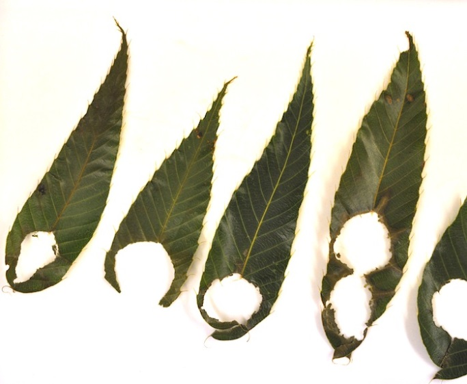

---
layout: doc
outline: deep
prev:
  text: 'Seminars'
  link: '/seminars/'
---

# 129th metaPhorest セミナー

2026年12月4日（金）19:00–21:00

## 129th metaPhorest Seminar by AKI INOMATA + 伊藤睦実 Mutsumi Ito

#### This event will be primarily in Japanese, but questions and comments in English are also welcome.
12/4（金）のmetaPhorestセミナーでは、アーティストのAKI INOMATAさんと、生態学を専門とする伊藤睦実さんをお招きします。ムササビのユニークな葉食行動に着目し、その食痕から広がる動物生態学研究の世界についてお話しいただきます。  
セミナー後の懇談タイムもあります。ぜひお越しください！  
  
2026年12月4日（金）19:00–21:00頃  
早稲田大学 先端生命医科学研究施設（TWIns）3F セミナールーム3  
https://www.waseda.jp/top/access/twins
  
::: warning
本セミナーではZoom配信を実施いたしません。ぜひ現地にてご聴講ください。
:::
  
#### ムササビはなぜ葉を折りたたむのか？
日本に生息する哺乳類の多くは夜行性で、森の中でひっそりと暮らしています。そのため、行動を直接観察してデータを集めることは容易ではありません。そこで哺乳類の研究では、糞や足跡、食べ痕などを手がかりに動物の存在や行動を調べる「痕跡調査」がよく用いられます。ムササビは、滑空という移動様式をもち、ほぼ一生を樹上で生活する夜行性の大型のリスです。これだけでも調査が難しい動物であることが想像できるかと思います。ところがありがたいことに、ムササビは葉を折りたたんで、折りたたんだところを食べるというような非常にユニークな食べ方をするため、食べ終わった葉には折り紙のように折り跡のついた独特な形の食べ痕（食痕）を残します。ムササビが不安定な木の上でわざわざそんなめんどうな食べ方をするのには、きっと何らかのワケがあるはずです。今回は、この食痕から生まれたさまざまな仮説とその検証、そして研究の過程で出会ったあまたの変人たちとの対話によって広がっていった、動物生態学研究の世界についてご紹介します。
  
#### 伊藤睦実 Mutsumi Ito
博士（理学）。生態学を専門とし、ムササビの葉食行動を題材とした植物と動物の相互作用に関する研究により2020年に首都大学東京にて学位を取得。現在は会社員に擬態しつつ、ひっそりと論文を執筆中。  
  
今回の関連論文

- Ito, M., Uenishi, M., Okano, R., & Hayashi, F. (2026). Origami by the Japanese giant flying squirrels: how to fold a tree leaf efficiently before eating it. acta ethologica, 29(1), 4.
- Ito, M., Seto, N., Rico, B., Shigeta, M., Tamura, N., & Hayashi, F. (2016). Folivory with leaf folding by giant flying squirrels: Its patterns and possible function. Ecological Research, 31(5), 617-626.
  
#### AKI INOMATA
アーティスト・武蔵野美術大学彫刻学科客員教授  
1983年、東京都生まれ。  
主な個展にボン美術館 (2026); 金沢21世紀美術館 (2022); 十和田市現代美術館 (2019); ナント美術館 (2018) など。主な国際展に上海ビエンナーレ (2025); バンコク・アート・ビエンナーレ (2024); あいち2022; トロント・ビエンナーレ (2019); 第22回ミラノ・トリエンナーレ (2019) など。主な収蔵先にニューヨーク近代美術館; 南オーストラリア州立美術館; カステッロ・ディ・リヴォリ現代美術館; 京都国立近代美術館; 森美術館; 金沢21世紀美術館など。
